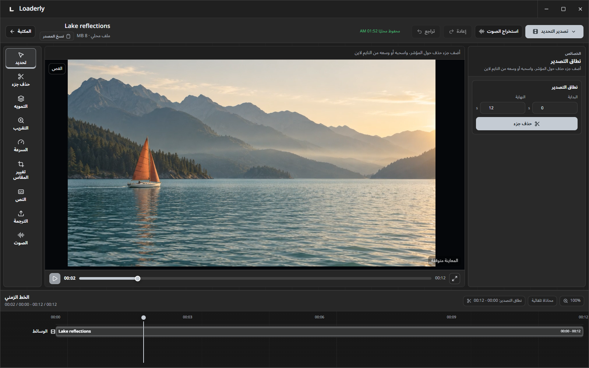
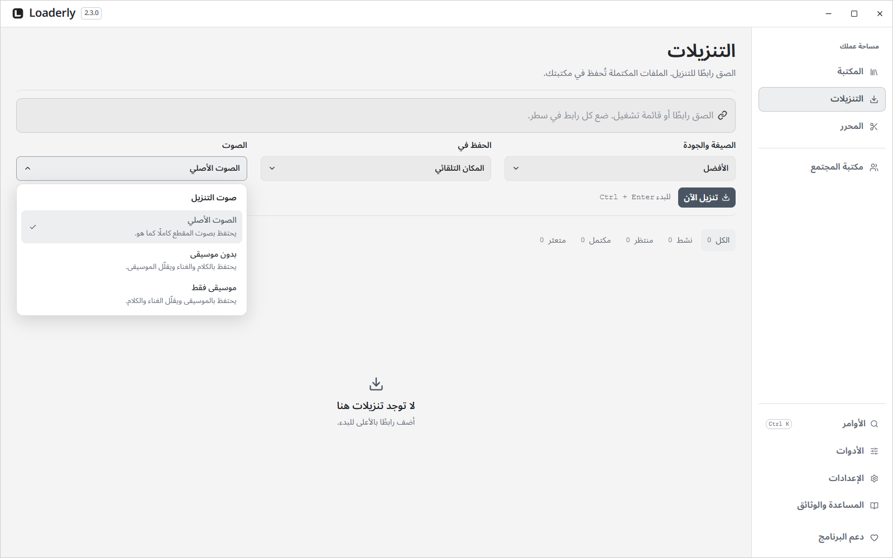
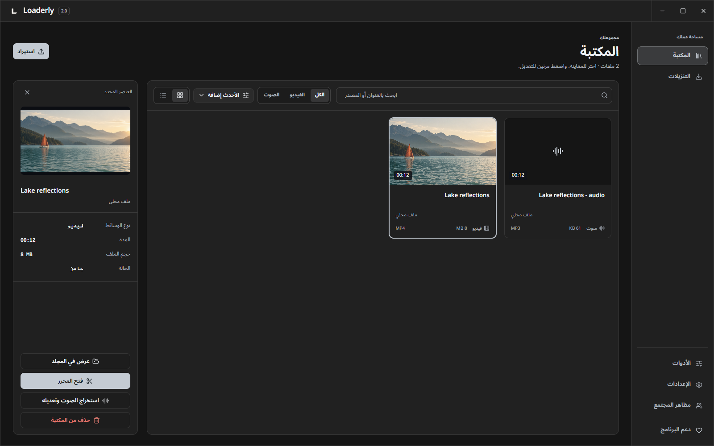
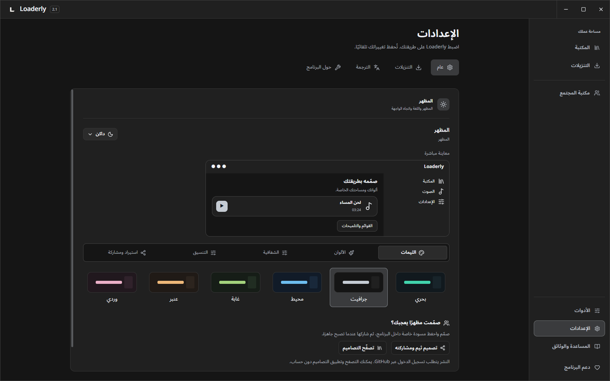
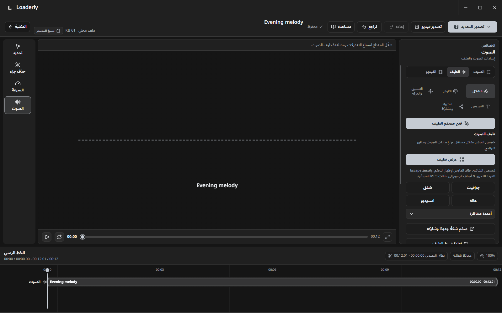

  
  <h1>Loaderly 2.0</h1>
  
مساحة واحدة على ويندوز لتنزيل الفيديو والصوت وتحريرهما.

  

    <a href="https://github.com/voidksa/Loaderly/releases/tag/v2.0.0"><strong>تنزيل لويندوز · v2.0</strong></a>
    · <a href="https://loaderly-docs.voidksa.workers.dev/ar/">الموقع والوثائق</a>
    · <a href="README.md">English</a>
  

أضف رابطًا أو ملفًا من جهازك، وعدّل المقطع، ثم صدّره من مكان واحد. يجمع Loaderly قائمة التنزيلات ومكتبة الوسائط وتحرير الفيديو والصوت والترجمة في واجهة تدعم العربية والإنجليزية.

## الجديد في 2.0

- **مساحة عمل جديدة:** أيقونة جديدة للبرنامج، ومكتبة وتنزيلات أوضح، ومحرر يضع المقطع في المقدمة.
- **تحرير الفيديو:** احذف أجزاء من المقطع، وأضف التمويه والتتبّع والتقريب والنصوص، وغيّر السرعة ومقاس الفيديو.
- **تحرير الصوت:** استخرج الصوت من فيديو أو افتح ملفًا صوتيًا، واضبط مستوى الصوت والتلاشي والجهير والحدّة، ثم احفظه بصيغة MP3.
- **السرعة وطابع الصوت:** اكتب السرعة مباشرة، أو استخدم الشريط والقيم الجاهزة. حافظ على طبقة الصوت، أو اجعلها تتغيّر مع السرعة، أو جرّب الصوت الدافئ أو الساطع أو طابع الراديو.
- **طيف صوت بطريقتك:** اختر الأعمدة أو الموجة أو الحلقة أو النقاط، أو ارسم شكلًا خاصًا في [المصمّم بالموقع](https://loaderly-docs.voidksa.workers.dev/ar/docs/audio-visualizer/#visualizer-builder). خصّص الألوان والحركة، وأخفِ النصوص لتسجيل الشاشة، وشارك المظهر بكود مستقل.
- **الترجمة:** راجع النصوص وعدّلها، ثم ترجمها باستخدام حسابك لدى أحد مزوّدي الذكاء الاصطناعي المدعومين.
- **تخصيص المظهر:** ستة مظاهر جاهزة، وألوان مستقلة للوضعين الفاتح والمظلم، وأكواد ألوان قابلة للنسخ واللصق، وتحكم بالمسافات والزوايا، ومشاركة المظهر بملف.

اقرأ [سجل تغييرات 2.0](CHANGELOG.md#20---2026-10-10)، أو ابدأ من [دليل الاستخدام الأول](https://loaderly-docs.voidksa.workers.dev/ar/docs/getting-started/).

## التنزيلات والمكتبة

الصق رابطًا واحدًا أو عدة روابط أو قائمة تشغيل مدعومة. اختر الجودة، وتابع التنزيلات، وأعد محاولة أي تنزيل لم يكتمل. افتح الملفات المنزّلة أو أضف ملفات الفيديو والصوت الموجودة على جهازك إلى المكتبة.

تشمل المصادر المدعومة YouTube وTikTok وInstagram وX وFacebook وVimeo وReddit وSoundCloud. يعتمد توفر التنزيل على الموقع المصدر وقيوده.

عرض مكتبة الوسائط

## خصّصه بطريقتك

اختر مظهرًا جاهزًا أو عدّل ألوان الوضعين الفاتح والمظلم. انسخ كود اللون، أو استورد مظهرًا، أو شارك تصميمك.

عرض تخصيص طيف الصوت

يخفي العرض النظيف واجهة التحرير لتسجيل الطيف بأداة تسجيل الشاشة. يحفظ تصدير الصوت ملف MP3 فقط، ولا ينشئ فيديو للطيف.

[أدلة الصوت والطيف](https://loaderly-docs.voidksa.workers.dev/ar/docs/audio/)

## التثبيت والتحديث

نزّل **Loaderly-Setup-2.0.exe** من [صفحة الإصدار 2.0](https://github.com/voidksa/Loaderly/releases/tag/v2.0.0). يدعم البرنامج **ويندوز 10 و11 بنواة 64 بت**، بواجهة عربية وإنجليزية.

أكمل التنزيلات والتصدير الجاري قبل التحديث، ثم شغّل المثبّت. يحتفظ التحديث بملفاتك وإعداداتك. راجع الخطوات في [دليل التثبيت](https://loaderly-docs.voidksa.workers.dev/ar/docs/installation/).

**تنتقل من الإصدار 1.x؟** إذا ظهرت رسالة تتطلب Windows Media Player في نافذة Watch / Trim القديمة، راجع [حل مشكلة المعاينة القديمة](https://loaderly-docs.voidksa.workers.dev/ar/docs/troubleshooting/#media-player). تخص الرسالة المشغّل القديم، ولا يُعد تثبيته شرطًا لمشغّل الإصدار 2.0.

## مظاهر المجتمع

اكتشف [ثيمات البرنامج](https://github.com/voidksa/Loaderly/discussions/categories/app-themes) و[أشكال طيف الصوت](https://github.com/voidksa/Loaderly/discussions/categories/audio-visualizers) من تصميم المجتمع. شارك تصميمك في القسم المناسب مع صورة والكود كاملًا. التصفّح متاح للجميع؛ ويحتاج النشر أو التعليق إلى حساب GitHub.

[طريقة مشاركة المظاهر وتركيبها](https://loaderly-docs.voidksa.workers.dev/ar/docs/community/).

## الخصوصية والدعم

يعمل التحرير على جهازك. تتصل التنزيلات بالموقع المصدر، وتُرسل نصوص الترجمة إلى المزوّد الذي تختاره عند طلب الترجمة بالذكاء الاصطناعي. التفاصيل في [دليل الملفات والخصوصية](https://loaderly-docs.voidksa.workers.dev/ar/docs/privacy/).

واجهت مشكلة؟ [افتح بلاغًا](https://github.com/voidksa/Loaderly/issues) مع خطوات تكرارها وصورة عند الحاجة. تجنّب إرفاق الملفات الخاصة وبيانات الحساب ومفاتيح API.

[ادعم Void](https://creators.sa/en/voidksa) إذا أحببت المساهمة في استمراري بالتطوير. الدعم اختياري.

## المصدر والترخيص

يتوفر مصدر Loaderly وفق [ترخيص PolyForm Noncommercial 1.0.0](LICENSE.md). يمكنك الاطلاع على الكود واستخدامه للأغراض غير التجارية التي يسمح بها الترخيص. يتطلب الاستخدام التجاري أو إعادة البيع أو إعادة تقديمه تجاريًا إذنًا منفصلًا.

احصل على مثبّت ويندوز من صفحة الإصدارات الرسمية المرتبطة أعلاه.

