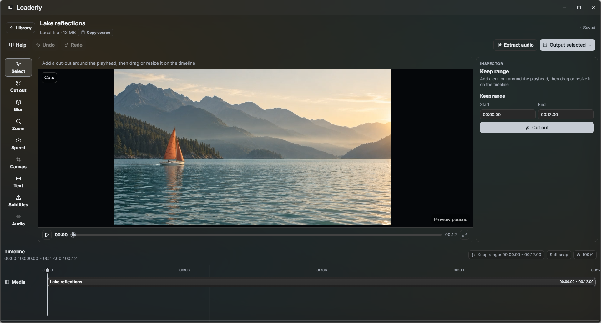
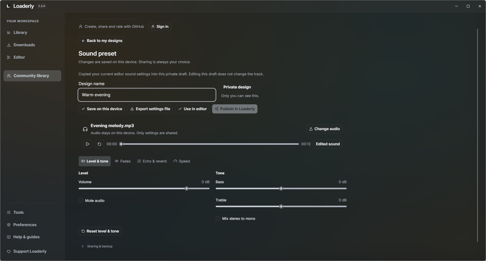
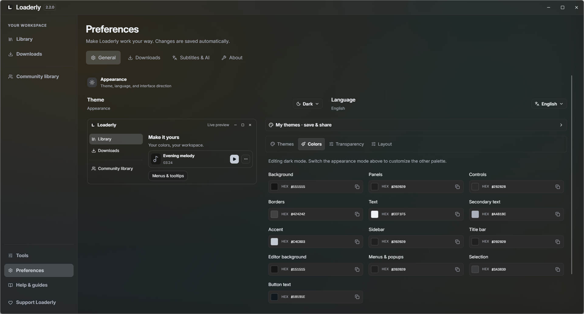

  
  <h1>Loaderly 2.1</h1>
  
Download, edit and make it yours. For Windows, macOS and Linux.

  
<a href="https://github.com/voidksa/Loaderly/releases/tag/v2.1.0"><strong>Download Loaderly</strong></a> · <a href="https://loaderly-docs.voidksa.workers.dev/">Website & documentation</a> · <a href="README.ar.md">العربية</a>

Bring in a link or a local file, refine your clip and export it from one workspace. Loaderly combines downloads, a media library, video and audio editing, subtitles and a community of shared designs. The interface and illustrated guides are available in English and Arabic.

## Download

| Your computer | Download |
| --- | --- |
| Windows 10 / 11, 64-bit | [Windows installer](https://github.com/voidksa/Loaderly/releases/download/v2.1.0/Loaderly-Setup-2.1.0.exe) |
| Mac with Apple Silicon | [Apple Silicon ZIP](https://github.com/voidksa/Loaderly/releases/download/v2.1.0/Loaderly-2.1.0-mac-arm64.zip) |
| Mac with Intel | [Intel ZIP](https://github.com/voidksa/Loaderly/releases/download/v2.1.0/Loaderly-2.1.0-mac-x64.zip) |
| Ubuntu / Debian, 64-bit | [DEB package](https://github.com/voidksa/Loaderly/releases/download/v2.1.0/Loaderly-2.1.0-linux-amd64.deb) |
| Other compatible Linux desktops, 64-bit | [AppImage](https://github.com/voidksa/Loaderly/releases/download/v2.1.0/Loaderly-2.1.0-linux-x86_64.AppImage) |

Follow the [installation guide](https://loaderly-docs.voidksa.workers.dev/docs/installation/) for your system. Updating keeps your library and preferences. Finish active downloads and exports before installing.

## New in 2.1

- **Community library:** find themes, visualizers and sound presets. Create a private draft, publish it from the app, and return to update or remove your publication.
- **Sound you can try:** import a preset code, choose an audio file from your device and compare the original with your adjustments before applying the preset. Your preview audio stays on your device.
- **Make the whole app yours:** customize colors, individual surfaces, transparency, text size, spacing, sidebar width and corners. Themes work across all three systems; desktop glass adapts to system support.
- **Music videos:** turn audio into a video with a moving visualizer, titles and your own cover or logo. Design shapes and words inside Loaderly.
- **Clearer editing:** readable time fields, easier dragging and resizing, sound changes for individual sections, and controls that follow your theme.
- **A tidier library:** choose which playlist items to download, resolve duplicate files, and decide whether to remove a file from Loaderly or move it to your computer's Trash.
- **Updates inside the app:** check for new versions in Preferences → About.

## Share from Loaderly

1. Open **Community library → Create & share**.
2. Choose **New theme**, **New visualizer** or **New sound preset**. It starts from your current settings. Already have a code? Use **Import code**.
3. Give it a name and try your changes. For sound, choose **Try your audio** and compare **Original sound** with **Edited sound**.
4. Sign in and choose **Publish in Loaderly**. **View my post** takes you to its public entry.
5. Later edits stay private until you choose **Publish update**.

Sign in with **GitHub** inside Loaderly to publish. Your designs appear in both the app and the [community website](https://loaderly-docs.voidksa.workers.dev/community/). The [illustrated guide](https://loaderly-docs.voidksa.workers.dev/docs/community/) explains drafts, publishing and updates.

## Start with one clip

Choose **Library → Import**, select a video or audio file and choose **Open editor**. Use the preview to see and hear your changes, then export a new file. Your original stays in place.

[Your first edit](https://loaderly-docs.voidksa.workers.dev/docs/getting-started/) · [Sound presets](https://loaderly-docs.voidksa.workers.dev/docs/sound-presets/) · [Design a visualizer](https://loaderly-docs.voidksa.workers.dev/docs/audio-visualizer/) · [Customize your theme](https://loaderly-docs.voidksa.workers.dev/docs/appearance/)

## Support and license

[Support Void](https://creators.sa/en/voidksa) if you would like to help keep Loaderly growing. Support is optional.

Loaderly is source-available under the [PolyForm Noncommercial License 1.0.0](LICENSE.md). You may inspect the source and use it for permitted noncommercial purposes. Commercial use, resale or commercial rebranding requires separate permission. See [NOTICE](NOTICE) for included software credits.

Build the desktop app from source

Use a current Node.js LTS installation. In `src/Loaderly.Electron`, run `npm ci`, then `npm run build` or `npm run dev`. The offline designer is included in the source. Official desktop downloads include the media tools required for downloading and exporting.

