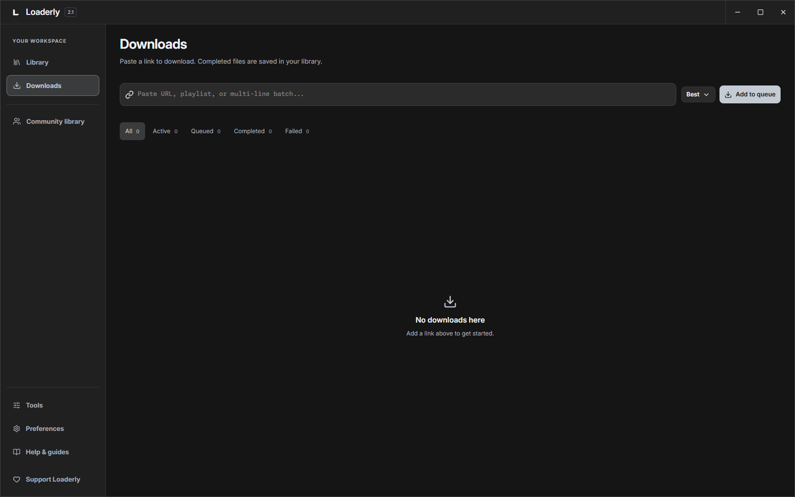
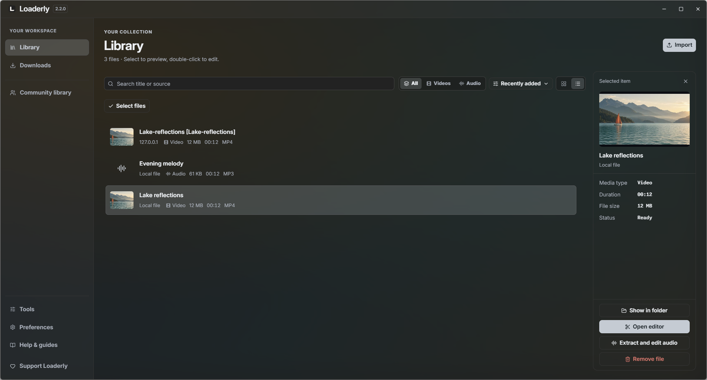
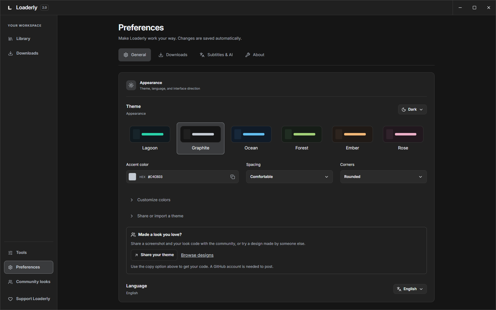
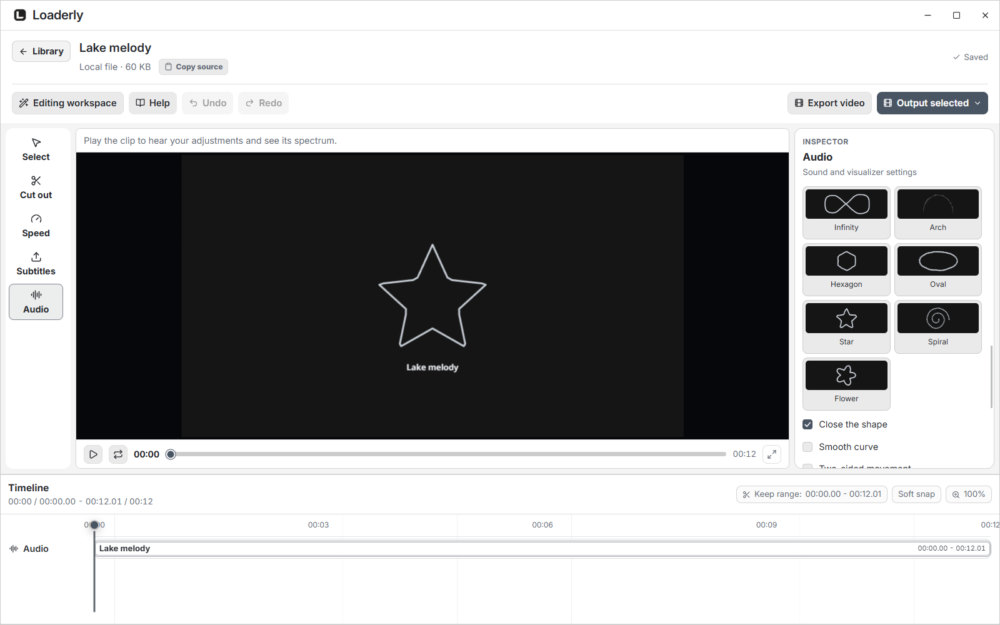

  
  <h1>Loaderly 2.0</h1>
  
A focused Windows workspace for downloading and editing video and audio.

  

    <a href="https://github.com/voidksa/Loaderly/releases/tag/v2.0.0"><strong>Download for Windows · v2.0</strong></a>
    · <a href="https://loaderly-docs.voidksa.workers.dev/">Website &amp; documentation</a>
    · <a href="README.ar.md">العربية</a>
  

Loaderly 2.0 introduces a **new visual identity and a completely redesigned app interface**. Bring in a link or a local file, refine your clip and export it from one workspace. Loaderly combines a download queue, a media library, video and audio editing, and subtitles in an interface that works in English and Arabic.

## What's new in 2.0

- **New visual identity and complete interface redesign:** a new app icon and a unified design across the Library, Downloads, video and audio editors, menus and preferences.
- **Video editing:** remove sections, blur and track an area, zoom, add text, change speed, and reframe for different screen sizes.
- **Audio editing:** extract sound from a video or open an audio file, adjust volume, fades, bass and treble, then save as MP3.
- **Speed and sound:** enter an exact rate, use the slider or pick a preset. Preserve the pitch, let it follow the speed, or try Warm, Bright and Radio sound.
- **Your own visualizer:** choose bars, a wave, a ring or dots, or draw a custom shape in the [online designer](https://loaderly-docs.voidksa.workers.dev/docs/audio-visualizer/#visualizer-builder). Customize colors and movement, hide labels for screen recording, and share the look with its own code.
- **Subtitles:** review and edit subtitles, then translate them with your own supported AI provider account.
- **Personalization:** six themes, separate light and dark palettes, color codes you can paste and copy, spacing and corner controls, and shareable theme files.

See the [full 2.0 changelog](CHANGELOG.md#20---2026-10-10) or follow the [getting started guide](https://loaderly-docs.voidksa.workers.dev/docs/getting-started/).

## Downloads and library

Paste a single link, several links or a supported playlist. Choose a quality, follow the queue and retry a failed download. Open downloaded files or import your own video and audio into the library.

Supported sources include YouTube, TikTok, Instagram, X, Facebook, Vimeo, Reddit and SoundCloud. Availability depends on the source and its restrictions.

See the media library

## Make it yours

Choose a preset or fine-tune both light and dark colors. Copy a color code, import a theme, or share your own.

See the audio visualizer

Clean view hides the editing interface so you can record the visualizer with a screen recorder. Audio export saves MP3 sound; it does not create a visualizer video.

[Audio and visualizer guides](https://loaderly-docs.voidksa.workers.dev/docs/audio/)

## Install or update

Download **Loaderly-Setup-2.0.exe** from the [2.0 release](https://github.com/voidksa/Loaderly/releases/tag/v2.0.0). Loaderly supports **Windows 10 and 11, 64-bit**, with English and Arabic interfaces.

Finish active downloads and exports before updating, then run the installer. Updating keeps your media and settings. See the [installation guide](https://loaderly-docs.voidksa.workers.dev/docs/installation/) for the steps.

**Coming from 1.x?** If the old Watch / Trim window reports that Windows Media Player is required, see the [legacy preview help](https://loaderly-docs.voidksa.workers.dev/docs/troubleshooting/#media-player). That message belongs to the older preview and is not a requirement for the 2.0 player.

## Community looks

Discover [app themes](https://github.com/voidksa/Loaderly/discussions/categories/app-themes) and [audio visualizers](https://github.com/voidksa/Loaderly/discussions/categories/audio-visualizers) made by the community. Share your own design in its category with a screenshot and the complete code. Browsing is open to everyone; publishing or commenting needs a GitHub account.

[How to share and import looks](https://loaderly-docs.voidksa.workers.dev/docs/community/).

## Privacy and support

Editing runs on your device. Downloads contact the source website; AI translation sends subtitle text to the provider you choose when you request it. Read the [files and privacy guide](https://loaderly-docs.voidksa.workers.dev/docs/privacy/).

Found a problem? [Open an issue](https://github.com/voidksa/Loaderly/issues) with the steps to reproduce it and a screenshot if useful. Leave out private files, account details and API keys.

[Support Void](https://creators.sa/en/voidksa) if you'd like to help me keep building. Support is optional.

## Source and license

Loaderly is source-available under the [PolyForm Noncommercial License 1.0.0](LICENSE.md). You can inspect the code and use it for permitted noncommercial purposes. Commercial use, resale or commercial rebranding requires separate permission.

Use the official releases linked above for the Windows installer.
